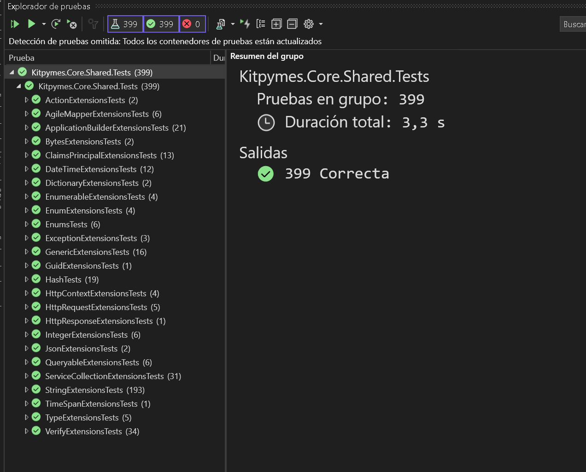

#  Kitpymes.Core.Shared

**Extensiones y utilidades comunes compartidas en los proyectos**

[](https://github.com/kitpymes/kitpymes-core-shared/actions/workflows/ci.yml)
[](https://www.nuget.org/packages/Kitpymes.Core.Shared/)
[](https://www.nuget.org/stats/packages/Kitpymes.Core.Shared?groupby=Version)
[](https://github.com/kitpymes/kitpymes-core-shared/blob/master/docs/LICENSE.txt)
[](https://github.com/kitpymes/kitpymes-core-shared/)
[](https://github.com/kitpymes/kitpymes-core-shared/)

## 📋 Requerimientos 

* Visual Studio 2026 o superior

* NET TargetFramework = net10.0

* SDK de .NET = 10.0.x

* C# = 12

* Conocimientos sobre Inyección de Dependencias

## 🔧 Instalación 

_Se puede instalar usando el administrador de paquetes Nuget o CLI dotnet._

_Nuget_

```
Install-Package Kitpymes.Core.Shared
```

_CLI dotnet_

```
dotnet add package Kitpymes.Core.Shared
```

## ⌨️ Código


### Kitpymes.Core.Shared.Extensions

```cs
public static class ActionExtensions
{
    [return: NotNull]
    public static TOptions ToConfigureOrDefault<TOptions>(this Action<TOptions>? action, TOptions? defaultOptions = null)
        where TOptions : class, new()) {}
}
```

```cs
public static class AgileMapperExtensions
{
    public static TSource ToMapClone<TSource>(this TSource source, params Expression<Action<IFullMappingInlineConfigurator<TSource, TSource>>>[] configurations)
        where TSource : class {}

    public static TDestination ToMapNew<TSource, TDestination>(this TSource source, params Expression<Action<IFullMappingInlineConfigurator<TSource, TDestination>>>[] configurations)
        where TSource : class
        where TDestination : class {}

    public static TDestination ToMapNew<TDestination>(this object source, params Expression<Action<IFullMappingInlineConfigurator<object, TDestination>>>[] configurations)
        where TDestination : class {}

    public static TDestination ToMapUpdate<TSource, TDestination>(this TSource source, TDestination destination, params Expression<Action<IFullMappingInlineConfigurator<TSource, TDestination>>>[] configurations)
        where TSource : class
        where TDestination : class {}

    public static TDestination ToMapMerge<TSource, TDestination>(this TSource source, TDestination destination, params Expression<Action<IFullMappingInlineConfigurator<TSource, TDestination>>>[] configurations)
        where TSource : class
        where TDestination : class {}

    public static IQueryable<TDestination> ToMapList<TSource, TDestination>(this IQueryable<TSource> queryable, Expression<Action<IFullProjectionInlineConfigurator<TSource, TDestination>>>? configuration = null)
        where TSource : class
        where TDestination : class {}
}
```

```cs
public static class ApplicationBuilderExtensions
{
    public static TEnviromentType? ToEnvironment<TEnviromentType>(this IApplicationBuilder application)
        where TEnviromentType : IHostEnvironment {}

    public static TEnviromentType? ToRequiredEnvironment<TEnviromentType>(this IApplicationBuilder application)
        where TEnviromentType : IHostEnvironment {}

    public static bool ToExists<TService>(this IApplicationBuilder application) {}

    public static TService ToRequiredService<TService>(this IApplicationBuilder application) {}

    public static TService? ToService<TService>(this IApplicationBuilder application) {}
}
```

```cs
public static class ByteExtensions
{
    [return: NotNull]
    public static byte[] ToCompress(this byte[] bytes) {}

    [return: NotNull]
    public static byte[] ToDecompress(this byte[] bytes) {}

    public static TResult? ToDecompress<TResult>(this byte[] bytes) {}

    public static TResult? ToObject<TResult>(this byte[] bytes) {}
}
```

```cs
public static class ClaimsPrincipalExtensions
{
    public static bool ToIsAuthenticated(this ClaimsPrincipal claimsPrincipal) {}

    public static string? ToAuthenticationType(this ClaimsPrincipal claimsPrincipal) {}

    public static string? ToUserName(this ClaimsPrincipal claimsPrincipal) {}

    public static bool ToExists(this ClaimsPrincipal claimsPrincipal, string claimType) {}

    public static void ToAddIdentity(this ClaimsPrincipal claimsPrincipal, string? authenticationType, IEnumerable<Claim>? claims) {}

    public static void ToAddIdentity<T>(this ClaimsPrincipal claimsPrincipal, string? authenticationType, params (string type, T value)[] claims) {}

    public static TResult? ToGet<TResult>(this ClaimsPrincipal claimsPrincipal, string claimType) {}

    public static TResult? ToGetValue<TResult>(this ClaimsPrincipal claimsPrincipal, string claimType) {}

    public static IEnumerable<TResult?>? ToGetAll<TResult>(this ClaimsPrincipal claimsPrincipal, string claimType) {}
}
```

```cs
public static class DateTimeExtensions
{
    public static bool ToIsWeekend(this DateTime input) {}

    public static int ToAge(this DateTime input) {}

    public static bool ToIsLastDayOfTheMonth(this DateTime input) {}

    public static DateTime ToEndOfTheMonth(this DateTime input) {}

    public static DateTime ToStartOfWeek(this DateTime input) {}

    public static DateTime ToYesterday(this DateTime input) {}

    public static DateTime ToTomorrow(this DateTime input) {}

    public static DateTime ToSetTime(this DateTime input, string time) {}

    public static DateTime ToSetTime(this DateTime input, int hours, int minutes, int seconds) {}
}
```

```cs
public static class DictionaryExtensions
{
    public static IDictionary<string, IEnumerable<string>> AddOrUpdate(this IDictionary<string, IEnumerable<string>>? dictionary, string key, string value) {}

    public static bool Contains(this IDictionary<string, IEnumerable<string>>? dictionary, string key, string value) {}

    public static IEnumerable<string>? GetValues(this IDictionary<string, IEnumerable<string>>? dictionary, string key) {}
}
```

```cs
public static class EnumerableExtensions
{
    public static string ToString<T>(this IEnumerable<T> enumerable, string separator) {}

    public static IEnumerable<T> ToEmptyIfNull<T>(this IEnumerable<T>? enumerable) {}

    public static ReadOnlyCollection<T> ToReadOnly<T>(this IEnumerable<T> enumerable) {}

    public static IEnumerable<Assembly> ToAssembly(this IEnumerable<string> assemblies) {}
}
```

```cs
public static class EnumExtensions
{
    public static int ToValue(this Enum name) {}

    public static string? ToDescription(this Enum name) {}

    public static (string? name, string? description) ToDisplay(this Enum name) {}

    public static TAttribute? ToAttribute<TAttribute>(this Enum name)
        where TAttribute : Attribute {}
}
```

```cs
public static class ExceptionExtensions
{
    public static string ToFullMessage(this Exception exception) {}

    public static string ToFullMessageDetail(this Exception exception, Action<ExceptionOptions>? options = null) {}
}
```

```cs
public static class GenericExtensions
{
    public static object? ToDefaultValue<T>(this T value) {}

    public static byte[] ToBytes<T>(this T value)
        where T : class {}

    public static IDictionary? ToDictionaryPropertyInfo<T>(this T input, bool includeNullOrEmptyProperty = false)
        where T : class {}
}
```

```cs
public static class GuidExtensions
{
     public static Guid ToSecuencial(this Guid input) {}
}
```

```cs
public static class HttpContextExtensions
{
    public static bool ToTryIPv6(this HttpContext httpContext, [MaybeNullWhen(false)] out string? ip) {}

    public static string? ToIPv6(this HttpContext httpContext) {}

    public static string ToDetails(this HttpContext httpContext, IDictionary<string, IEnumerable<string>>? optionalData = null) {}
}
```

```cs
public static class HttpRequestExtensions
{
    public static bool ToTryHeader(this HttpRequest httpRequest, string key, [MaybeNullWhen(false)] out ReadOnlyCollection<string?>? values) {}

    public static ReadOnlyCollection<string?>? ToHeader(this HttpRequest httpRequest, string key) {}

    public static string ToPath(this HttpRequest httpRequest) {}

    public static string? ToSubdomain(this HttpRequest httpRequest) {}

    public static bool ToTryContentType(this HttpRequest httpRequest, [MaybeNullWhen(false)] out string? contentType) {}
}
```

```cs
public static class HttpResponseExtensions
{
     public static async Task ToResultAsync(this HttpResponse httpResponse, HttpStatusCode status, string message, string contentType = MediaTypeNames.Application.Json, IDictionary<string, IEnumerable<string>>? headers = null) {}
}
```

```cs
public static class IntegerExtensions
{
    [return: NotNull]
    public static string ToStringFormat(this int input, IFormatProvider? formatProvider = null) {}
}
```

```cs
public static class JsonExtensions
{
    public static string ToSerialize<T>(this T value, Action<JsonSerializerOptions>? action = null) {}

    public static T? ToDeserialize<T>(this string value, Action<JsonSerializerOptions>? action = null) {}
}
```

```cs
public static class QueryableExtensions
{
    public static IQueryable<T> ToWhere<T>(this IQueryable<T> queryable, Expression<Func<T, bool>>? where) {}

    public static IQueryable<T> ToPaged<T>(this IQueryable<T> queryable, string property, bool ascending = true, int index = 1, int size = 20) {}
}
```

```cs
public static class ServiceCollectionExtensions
{
    public static TEnviromentType? ToEnvironment<TEnviromentType>(this IServiceProvider services)
        where TEnviromentType : IHostEnvironment {}

    public static TEnviromentType? ToEnvironment<TEnviromentType>(this IServiceCollection services) {}

    public static bool ToExists<TService>(this IServiceCollection services) {}

    public static TService? ToService<TService>(this IServiceCollection services) {}

    public static IServiceCollection ToServiceMatchingClass(this IServiceCollection services, Type implementation, Assembly[] assemblies, ServiceLifetime lifetime = ServiceLifetime.Transient) {}

    public static IServiceCollection ToServiceMatchingClass<TImplementation>(this IServiceCollection services, Assembly[] assemblies, ServiceLifetime lifetime = ServiceLifetime.Transient)
        where TImplementation : class {}

    public static IServiceCollection ToServiceMatchingInterface(this IServiceCollection services, Assembly[] assemblies, ServiceLifetime lifetime = ServiceLifetime.Transient) {}

    public static IServiceCollection ToServiceMatchingInterface<TInterface>(this IServiceCollection services, Assembly[] assemblies, ServiceLifetime lifetime = ServiceLifetime.Transient) {}

    public static IServiceCollection ToConfiguration(this IServiceCollection services, string directoryPath, params (string jsonFileName, bool optional, bool reloadOnChange)[] files) {}

    public static IServiceCollection ToConfiguration(this IServiceCollection services, params (string key, string? value)[] configuration) {}

    public static IServiceCollection ToConfiguration(this IServiceCollection services, IConfiguration configuration) {}

    public static TSettings? ToSettings<TSettings, TConfigureSettings>(this IServiceCollection services, Action<TSettings>? defaultSettings = null) {}

    public static TSettings ToSettings<TSettings>(this IServiceCollection services, TSettings? defaultSettings = null)
        where TSettings : class, new() {}
}
```

```cs
public static class StringBuilderExtensions
{
    public static StringBuilder ToAppend(this StringBuilder stringBuilder, string format) {}
}
```

```cs
public static class StringExtensions
{
    public static string? ToRemove(this string? input, params string[] removes) {}

    public static string? ToReplace(this string? input, string replace, int start, int count) {}

    public static string? ToReplaceSpecialChars(this string? input, params string[] ignoreSpecialChars) {}

    public static string? ToNormalize(this string? input) {}

    public static TEnum ToEnum<TEnum>(this string? input, TEnum defaultValue = default)
        where TEnum : struct, Enum {}

    public static TEnum ToEnum<TEnum>(this int input, TEnum defaultValue = default)
        where TEnum : struct, Enum {}

    [return: NotNull]
    public static string ToFirstLetterUpper(this string? input) {}

    [return: NotNull]
    public static string ToFirstLetterLower(this string input) {}

    public static string? ToEmailMaskUserName(this string? input, char replace = '*') {}

    public static string? ToEmailMaskUserNameAndDomain(this string? input, char replace = '*') {}

    public static string? ToEmailMaskUserNameAndDomainAndExtension(this string? input, char replace = '*') {}

    public static string? ToEmailMask(this string? input, string pattern, char replace) {}

    public static Uri? ToUri(this string? input, Uri? defaultValue = null) {}

    public static HashAlgorithmName? ToHashAlgorithmName(this string? input, HashAlgorithmName? defaultValue = null) {}

    public static int? ToInt(this string? input, int? defaultValue = null) {}

    public static void ToZipCreate(
        this string? sourceDirectoryPath,
        string? destinationDirectoryPath,
        string? customZipName = null,
        CompressionLevel compressionLevel = CompressionLevel.Optimal,
        bool removeSourceDirectoryPath = false) {}

    public static void ToZipExtract(
        this string? sourceFilePath,
        string? destinationDirectoryPath,
        bool overwriteFiles = false) {}

    public static string ToContentType([NotNull] this string? fileName, string defaultValue = MediaTypeNames.Application.Octet) {}

    public static string? ToDirectoryFindFilePath(this string? directoryPath, string fileName, bool ignoreCase = true) {}

    public static FileInfo? ToDirectoryFileInfo(this string? directoryPath, string fileName) {}

    public static void ToDirectoryDeleteFiles(this string directoryPath, bool recursive = false, bool directoryDelete = false) {}

    public static async Task ToDirectorySaveFileAsync(this string directoryPath, string fileName, byte[] bytes, bool ifNoExistDirectoryCreate = true) {}

    public static async Task<(string fileName, string filePath, string fileConvert, byte[] fileBytes, long fileLength, string fileContentType)?> ToDirectoryReadFileAsync(this string directoryPath, string fileName) {}

    public static async Task<List<(string fileName, string filePath, string fileConvert, byte[] fileBytes, long fileLength, string fileContentType)?>?> ToDirectoryReadFilesAsync(
        this string directoryPath, 
        SearchOption searchOption = SearchOption.AllDirectories,
        params string[] includeExtensions) {}

    public static string ToDirectoryTemporary(this string folderName) {}

    public static string ToFormat(this string value, params object[] args) {}

    public static string ToFormat(this string value, IFormatProvider formatProvider, params object[] args) {}

    public static Assembly ToAssembly(this string assembly) {}

    public static string? ToRandom(this string input, int length) {}
}
```

```cs
public static class TimeSpanExtensions
{
    public static string ToFormat(this TimeSpan time) {}
}
```

```cs
public static class TypeExtensions
{
    public static object? ToDefaultValue(this Type type) {}

    public static IDictionary? ToDictionary(this Type type) {}

    public static Assembly ToAssembly(this Type type) {}
}
```

```cs
public static class VerifyExtensions
{
    public static bool ToIsNullOrEmpty([NotNullWhen(false)] this object? argument) {}

    public static TArgument ToThrowIfNullOrEmpty<TArgument>([NotNull] this TArgument? argument, [CallerArgumentExpression(nameof(argument))] string? argumentName = null, string? message = null) {}

    public static bool ToIsNullOrAny([NotNullWhen(false)] this IEnumerable? argument) {}

    public static IEnumerable<TArgument> ToThrowIfNullOrAny<TArgument>([NotNull] this IEnumerable<TArgument>? argument, [CallerArgumentExpression(nameof(argument))] string? argumentName = null) {}

    public static bool ToIsGreater([NotNullWhen(true)] this object? argument, long min) {}

    public static bool ToIsGreaterOrEqual([NotNullWhen(true)] this object? argument, long min) {}

    public static TArgument ToThrowIfGreater<TArgument>([NotNull] this TArgument? argument, long min, [CallerArgumentExpression(nameof(argument))] string? argumentName = null) {}

    public static TArgument ToThrowIfGreaterOrEqual<TArgument>([NotNull] this TArgument? argument, long min, [CallerArgumentExpression(nameof(argument))] string? argumentName = null) {}

    public static bool ToIsLess([NotNullWhen(true)] this object? argument, long max) {}

    public static bool ToIsLessOrEqual([NotNullWhen(true)] this object? argument, long max) {}

    public static TArgument ToThrowIfLess<TArgument>([NotNull] this TArgument? argument, long max, [CallerArgumentExpression(nameof(argument))] string? argumentName = null) {}

    public static TArgument ToThrowIfLessOrEqual<TArgument>([NotNull] this TArgument? argument, long max, [CallerArgumentExpression(nameof(argument))] string? argumentName = null) {}

    public static bool ToIsEqual([NotNullWhen(true)] this object? argument, object? argumentCompare) {}

    public static TArgument ToThrowIfNotEqual<TArgument>(
        [NotNull] this TArgument? argument,
        TArgument argumentCompare,
        [CallerArgumentExpression(nameof(argument))] string? argumentName = null,
        [CallerArgumentExpression(nameof(argumentCompare))] string? argumentCompareName = null) {}

    public static bool ToIsInsideRange([NotNullWhen(true)] this object? argument, long min, long max) {}

    public static bool ToIsInsideOrEqualRange([NotNullWhen(true)] this object? argument, long min, long max) {}

    public static TArgument ToThrowIfInsideRange<TArgument>(
        [NotNull] this TArgument? argument,
        long min,
        long max,
        [CallerArgumentExpression(nameof(argument))] string? argumentName = null) {}

    public static TArgument ToThrowIfInsideOrEqualRange<TArgument>(
        [NotNull] this TArgument? argument,
        long min,
        long max,
        [CallerArgumentExpression(nameof(argument))] string? argumentName = null) {}

    public static bool ToIsOutRange([NotNullWhen(true)] this object? argument, long min, long max) {}

    public static bool ToIsOutOrEqualRange([NotNullWhen(true)] this object? argument, long min, long max) {}

    public static TArgument ToThrowIfOutRange<TArgument>(
        [NotNull] this TArgument? argument,
        long min,
        long max,
        [CallerArgumentExpression(nameof(argument))] string? argumentName = null) {}

    public static TArgument ToThrowIfOutOrEqualRange<TArgument>(
        [NotNull] this TArgument? argument,
        long min,
        long max,
        [CallerArgumentExpression(nameof(argument))] string? argumentName = null) {}

    public static bool ToIsRegexMatch([NotNullWhen(true)] this string? argument, string regex) {}

    public static string ToThrowIfRegexNotMatch([NotNull] this string? argument, string regex, [CallerArgumentExpression(nameof(argument))] string? argumentName = null) {}

    public static bool ToIsDirectory([NotNullWhen(true)] this string? argument) {}

    public static string? ToThrowIfDirectoryNotExists([NotNull] this string? argument, [CallerArgumentExpression(nameof(argument))] string? argumentName = null) {}

    public static bool ToIsFile([NotNullWhen(true)] this string? argument) {}

    public static string ToThrowIfFileNotExists([NotNull] this string? argument, [CallerArgumentExpression(nameof(argument))] string? argumentName = null, string? message = null) {}

    public static bool ToIsFileExtension([NotNullWhen(true)] this string? argument) {}

    public static string ToThrowIfNotFileExtension([NotNull] this string? argument, [CallerArgumentExpression(nameof(argument))] string? argumentName = null) {}

    public static bool ToIsName([NotNullWhen(true)] this string? argument) {}

    public static string ToThrowIfNotName([NotNull] this string? argument, [CallerArgumentExpression(nameof(argument))] string? argumentName = null) {}

    public static bool ToIsEmail([NotNullWhen(true)] this string? argument) {}

    public static string ToThrowIfNotEmail([NotNull] this string? argument, [CallerArgumentExpression(nameof(argument))] string? argumentName = null) {}

    public static bool ToIsSubdomain([NotNullWhen(true)] this string? argument) {}

    public static string ToThrowIfNotSubdomain([NotNull] this string? argument, [CallerArgumentExpression(nameof(argument))] string? argumentName = null) {}

    public static bool ToIsDomain([NotNullWhen(true)] this string? argument) {}

    public static string ToThrowIfNotDomain([NotNull] this string? argument, [CallerArgumentExpression(nameof(argument))] string? argumentName = null) {}

    public static bool ToIsHostname([NotNullWhen(true)] this string? argument) {}

    public static string ToThrowIfNotHostname([NotNull] this string? argument, [CallerArgumentExpression(nameof(argument))] string? argumentName = null) {}

    public static bool ToIsContainsDigit([NotNullWhen(true)] this string? argument) {}

    public static string ToThrowIfNotContainsDigit([NotNull] this string? argument, [CallerArgumentExpression(nameof(argument))] string? argumentName = null) {}

    public static bool ToIsContainsUniqueChars([NotNullWhen(true)] this string? argument) {}

    public static string ToThrowIfNotContainsUniqueChars([NotNull] this string? argument, [CallerArgumentExpression(nameof(argument))] string? argumentName = null) {}

    public static bool ToIsContainsEspecialChars([NotNullWhen(true)] this string? argument) {}

    public static string ToThrowIfNotContainsEspecialChars([NotNull] this string? argument, [CallerArgumentExpression(nameof(argument))] string? argumentName = null) {}

    public static bool ToIsLowercase([NotNullWhen(true)] this string? argument) {}

    public static string ToThrowIfNotLowercase([NotNull] this string? argument, [CallerArgumentExpression(nameof(argument))] string? argumentName = null) {}

    public static bool ToIsUppercase([NotNullWhen(true)] this string? argument) {}

    public static string ToThrowIfNotUppercase([NotNull] this string? argument, [CallerArgumentExpression(nameof(argument))] string? argumentName = null) {}

    public static TValue ToThrowIf<TValue>([NotNull] this TValue? argument, string message, Func<bool> condition) {}
}
```

### Kitpymes.Core.Shared.Util

```cs
public static class Enums
{
   public static int ToCount<TEnum>()
        where TEnum : Enum {}

    public static IEnumerable<string?> ToValues<TEnum>()
         where TEnum : struct, Enum {}

    public static IEnumerable<TEnum> ToList<TEnum>()
        where TEnum : struct, Enum {}

    public static IEnumerable<(int value, string text, bool selected)> ToList<TEnum>(Type? resourceType = null, TEnum? selected = null)
        where TEnum : struct, Enum {}
}
```

```cs
public static class Hash
{
    public static string CreateRandom(int length = 6, string validChars = "ABCDEFGHJKLMNOPQRSTUVWXYZ0123456789abcdefghijklmnopqrstuvwxyz!¡@#$%€^&*?¿_-+") {}

    [return: NotNull]
    public static string CreateSHA256(string text) {}

    public static bool VerifySHA256(string text, string hash) {}

    [return: NotNull]
    public static string CreateSHA512(string text) {}

    public static bool VerifySHA512(string text, string hash) {}
}
```

```cs
public static class Messages
{
    public static string FieldNullOrEmpty(string? fieldName = null) {}

    public static string FieldNullOrAny(string? fieldName = null) {}

    public static string FieldRequired(string? fieldName = null) {}

    public static string FieldInvalidFormat(string? fieldName = null) {}

    public static string FieldGreater(long min, string? fieldName = null) {}

    public static string FieldGreaterOrEqual(long min, string? fieldName = null) {}

    public static string FieldLess(long max, string? fieldName = null) {}

    public static string FieldLessOrEqual(long max, string? fieldName = null) {}

    public static string FieldEqual(string? fieldName = null, string? fieldNameCompare = null) {}

    public static string FieldInsideRange(long min, long max, string? fieldName = null) {}

    public static string FieldInsideOrEqualRange(long min, long max, string? fieldName = null) {}

    public static string FieldOutRange(long min, long max, string? fieldName = null) {}

    public static string FieldOutOrEqualRange(long min, long max, string? fieldName = null) {}

    public static string FieldDirectory(string? value = null, string? fieldName = null) {}

    public static string FieldFile(string? value = null, string? fieldName = null) {}

    public static string Email(string? value = null, string? fieldName = null) {}

    public static string FieldFileExtension(string? value = null, string? fieldName = null) {}

    public static string Name(string? value = null, string? fieldName = null) {}

    public static string Password(long min, string? fieldName = null) {}

    public static string Subdomain(string? value = null, string? fieldName = null) {}

    public static string NotFound(string? fieldName = null) {}
}
```

```cs
public static class Regexp
{
    public const string ForDate = @"^((((0?[1-9]|[12]\d|3[01])[\.\-\/](0?[13578]|1[02])[\.\-\/]((1[6-9]|[2-9]\d)?\d{2}))|((0?[1-9]|[12]\d|30)[\.\-\/](0?[13456789]|1[012])[\.\-\/]((1[6-9]|[2-9]\d)?\d{2}))|((0?[1-9]|1\d|2[0-8])[\.\-\/]0?2[\.\-\/]((1[6-9]|[2-9]\d)?\d{2}))|(29[\.\-\/]0?2[\.\-\/]((1[6-9]|[2-9]\d)?(0[48]|[2468][048]|[13579][26])|((16|[2468][048]|[3579][26])00)|00)))|(((0[1-9]|[12]\d|3[01])(0[13578]|1[02])((1[6-9]|[2-9]\d)?\d{2}))|((0[1-9]|[12]\d|30)(0[13456789]|1[012])((1[6-9]|[2-9]\d)?\d{2}))|((0[1-9]|1\d|2[0-8])02((1[6-9]|[2-9]\d)?\d{2}))|(2902((1[6-9]|[2-9]\d)?(0[48]|[2468][048]|[13579][26])|((16|[2468][048]|[3579][26])00)|00)))) ?((20|21|22|23|[01]\d|\d)(([:.][0-5]\d){1,2}))?$";

    public const string ForDecimal = @"^((-?[1-9]+)|[0-9]+)(\.?|\,?)([0-9]*)$";

    public const string ForEmail = @"^([\w\.\-]+)@([\w\-]+)((\.(\w){2,3})+)$";

    public const string ForHex = "^#?([a-f0-9]{6}|[a-f0-9]{3})$";

    public const string ForInteger = "^((-?[1-9]+)|[0-9]+)$";

    public const string ForTag = @"^<([a-z1-6]+)([^<]+)*(?:>(.*)<\/\1>| *\/>)$";

    public const string ForTime = @"^([01]?[0-9]|2[0-3]):[0-5][0-9]$";

    public const string ForUrl = @"^((https?|ftp|file):\/\/)?([\da-z\.-]+)\.([a-z\.]{2,6})([\/\w \.-]*)*\/?$";

    public const string ForName = @"^[a-zA-Z áàäâãÁÀÄÂÃÅéèëêÉÈËÊíìïîÍÌÏÎóòöôõøÓÒÖÔÕúùüûÚÙÜÛçÇħñÑ]*$";

    public const string ForSubdomain = @"^[-._a-zA-Z0-9]*$";

    public const string ForDomain = @"(?=^.{1,254}$)(^(?:(?!\d+\.|-)[a-zA-Z0-9_\-]{1,63}(?<!-)\.?)+(?:[a-zA-Z]{2,})$)";

    public const string ForHostname = @"^(([a-zA-Z0-9]|[a-zA-Z0-9][a-zA-Z0-9\-]*[a-zA-Z0-9])\.)*([A-Za-z0-9]|[A-Za-z0-9][A-Za-z0-9\-]*[A-Za-z0-9])$";
}
```

```cs
public class SharedException : Exception
{
    public SharedException() {}

    public SharedException(string? message)
        : base(message) {}

    public SharedException(string? message, Exception? innerException)
        : base(message, innerException) {}
}
```

```cs
public static class Verify
{
    [DoesNotReturn]
    public static void ToThrowIf<TException>(string message, Func<bool> condition)
        where TException : Exception {}
}
```


## ⚙️ Pruebas Unitarias

_Cada proyecto tiene su test que se ejecutan desde el "Explorador de pruebas"_




## 🛠️ Construido con 

* [NET Core](https://dotnet.microsoft.com/download) - Framework de trabajo
* [C#](https://docs.microsoft.com/es-es/dotnet/csharp/) - Lenguaje de programación
* [Inserción de dependencias](https://docs.microsoft.com/es-es/aspnet/core/fundamentals/dependency-injection?view=aspnetcore-3.0) - Patrón de diseño de software
* [MSTest](https://docs.microsoft.com/es-es/dotnet/core/testing/unit-testing-with-mstest) - Pruebas unitarias
* [Nuget](https://www.nuget.org/) - Manejador de dependencias
* [Visual Studio](https://visualstudio.microsoft.com/) - Entorno de programacion


## ✒️ Autores 

* **Sebastian R Ferrari** - *Trabajo Inicial* - [kitpymes](https://kitpymes.com)


## 📄 Licencia 

* Este proyecto está bajo la Licencia [LICENSE](LICENSE.txt)


## 🎁 Gratitud 

* Este proyecto fue diseñado para compartir, creemos que es la mejor forma de ayudar 📢
* Cada persona que contribuya sera invitada a tomar una 🍺 
* Gracias a todos! 🤓

---
[Kitpymes](https://github.com/kitpymes) 😊